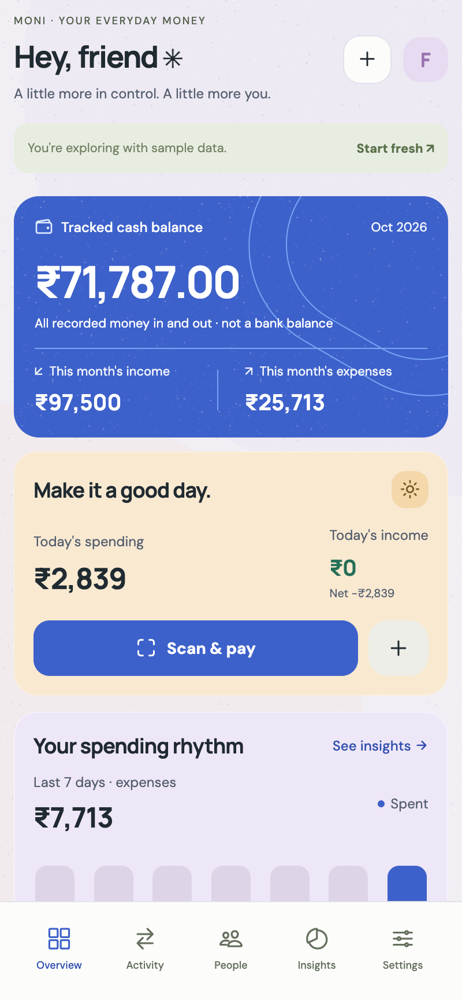
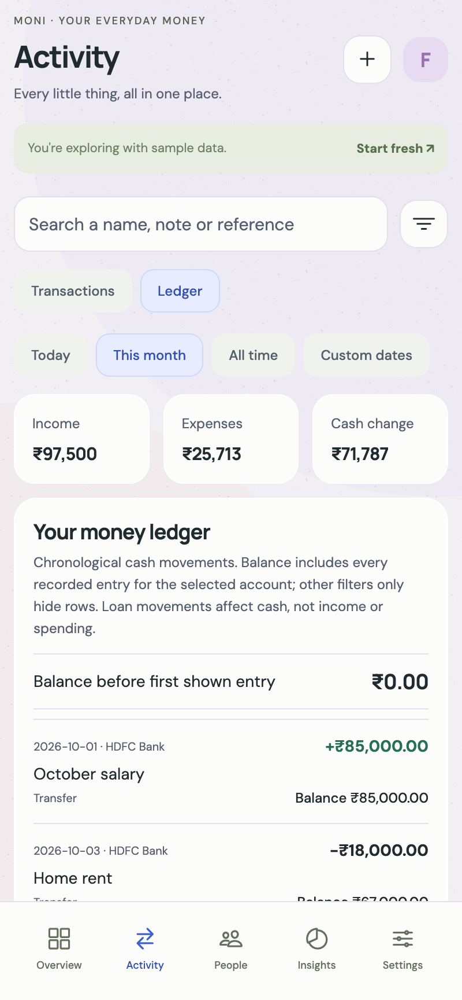
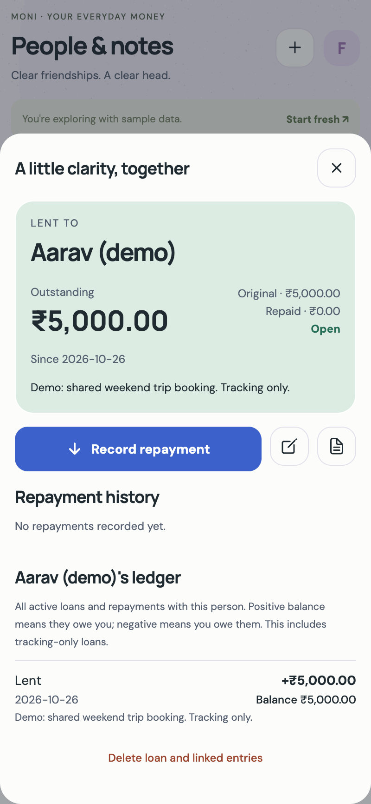
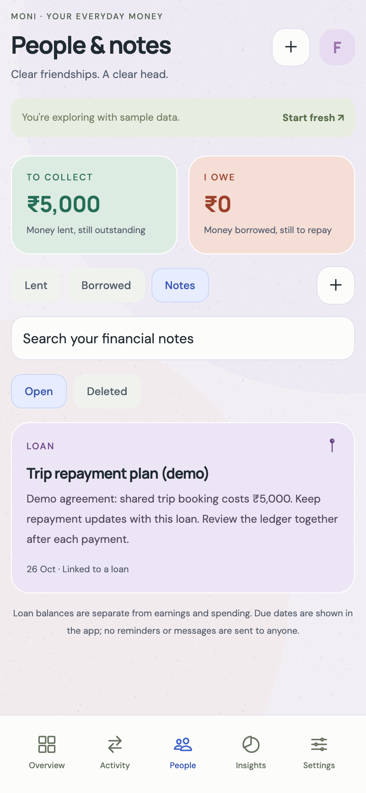
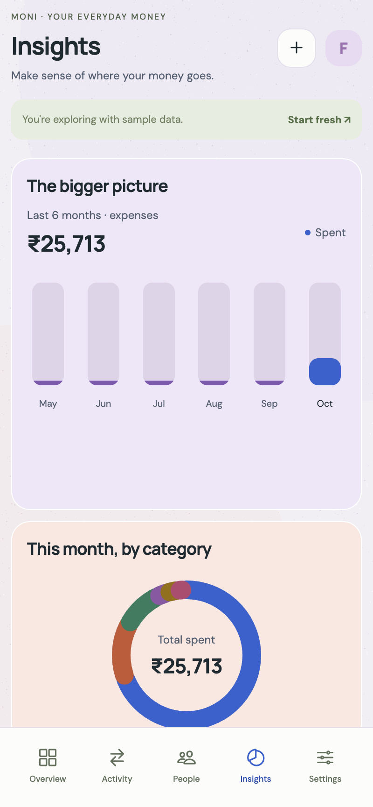
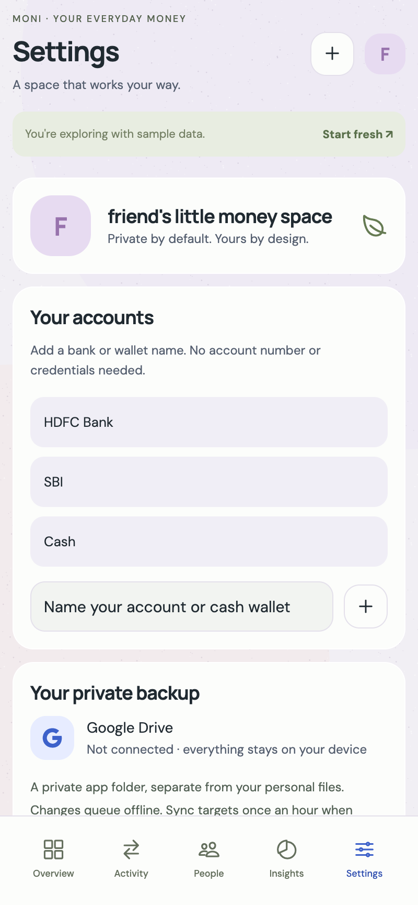
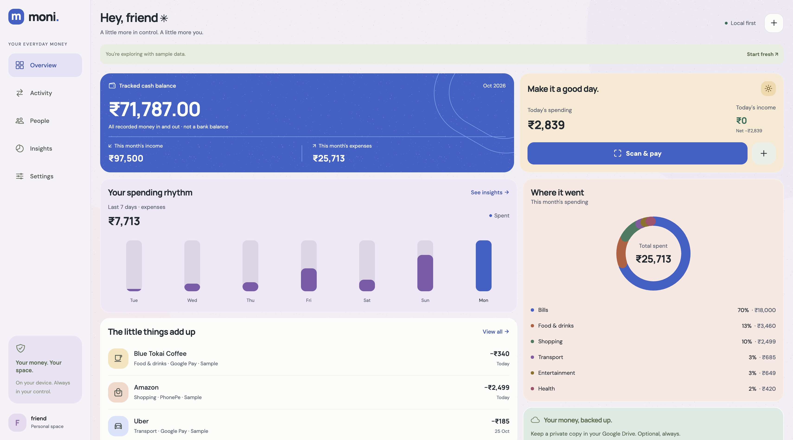
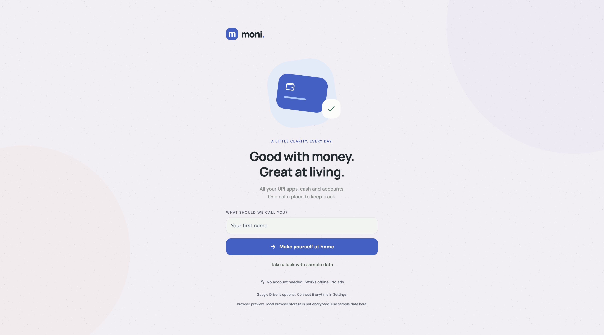

# Moni


**Your everyday money, a little clearer.** An open source expense tracker for India, with UPI scan-and-confirm, loans, notes and ledgers. Built with React Native, Expo and TypeScript.

**Contributors welcome!** Help make private, simple money tracking better. See [CONTRIBUTING.md](CONTRIBUTING.md) for setup, ideas and pull request guidance.

## Screenshots

These are browser-preview captures with synthetic demo data. Native Android uses the same React Native screens; system payment, camera and Google dialogs are Android-only.

### Mobile screens

Dashboard, ledger, loan details, notes, insights and settings at a **400px phone viewport** (800 × 1728 captures). Tap any image for the full-size view. These are responsive browser-preview captures, not Android device screenshots.

<p>
  <a href="docs/screenshots/mobile-overview.png"></a>
  <a href="docs/screenshots/mobile-ledger.png"></a>
  <a href="docs/screenshots/mobile-loan.png"></a>
</p>

<p>
  <a href="docs/screenshots/mobile-notes.png"></a>
  <a href="docs/screenshots/mobile-insights.png"></a>
  <a href="docs/screenshots/mobile-settings.png"></a>
</p>

<details><summary>Desktop dashboard</summary>



</details>

<details><summary>Welcome and onboarding</summary>



</details>


A local-first React Native / TypeScript money tracker for Android. Colorful matte surfaces, fine vector grain, blue balance card, coral and lavender analytics, mint backup card, and a compact scan-and-confirm payment flow. Mobile page margins are 12px, card padding 16px and most section gaps 12px. Settings uses two columns on wider screens and the normal reading order on phones.

## Start here

```sh
git clone https://github.com/Fauzan-coder/moni.git
cd moni
npm ci
npm run web
```

The browser preview supports onboarding, sample data, manual entry, editing/deleting, filters, analytics, lending/borrowing, partial repayments, personal and cash ledgers, financial notes, JSON export/restore and revision recovery. It stores data in **unencrypted browser localStorage**, separately from Android. Use sample data in the preview. Native payments, Google sign-in, encrypted storage and notification access require the Android build, not Expo Go.

### Run on Android

Install Node 22+, Android Studio, SDK 36, Android build tools 35.0.0 and 36.0.0 and a Java 17+ runtime (Android Studio's bundled JBR works). Connect an Android phone with USB debugging, or start an emulator. Then:

```sh
npm run android
```

Expo prebuild automatically links the local `modules/moni-android` Kotlin module and the native packages. No custom manifest editing is needed. If Android tooling isn't found on macOS:

```sh
export JAVA_HOME="/Applications/Android Studio.app/Contents/jbr/Contents/Home"
export ANDROID_HOME="$HOME/Library/Android/sdk"
export PATH="$ANDROID_HOME/platform-tools:$PATH"
npm run android
```

For a standalone installable APK, run `npx eas-cli build --platform android --profile preview` after signing into your own Expo account. This invokes Expo's build service and uploads source; run it yourself if you choose this route. `eas.json` also includes development and Play Store profiles. Alternatively build locally with `npx expo run:android --variant release`. Configure your own release signing key before distributing; the generated project's default debug key is for development only.

## New-user experience

1. Enter a first name, tap **Make yourself at home**. No login or permissions are needed.
2. Add an income/expense, or open **Scan & pay** and grant camera access at that point. Cash and transfers work too.
3. Start with no seeded banks. Add your own bank, wallet or cash account in **Settings → Your accounts**, or directly in the transaction form. Account choices, filters and summaries come from your saved labels and visible transactions. You can remove unused account labels; banks from the sample tour never become real defaults.
4. Optionally choose **Settings → Connect Google Drive**. In a configured build, choose a Google account and approve only private app-data storage.
5. Optionally enable payment suggestions after reading the notification-access explanation.

**Take a look with sample data** is an explicit tour. The banner labels the data, sample revisions never upload to Drive, and **Start fresh** removes only sample transactions. Finish the tour before connecting Drive.

Android date fields include a calendar button. Typed dates such as `2026-3-25` are normalized to `2026-03-25` before saving. Impossible dates are rejected with field-specific errors.

## Loans, notes and ledgers

Open **People** to record money lent or borrowed, a person, date, optional due date and agreement note. Record partial or full repayments; outstanding and overdue balances update immediately. Each person's detail includes a running ledger across their loans. Undo a mistaken repayment, or recover deleted loans and notes from the Deleted filter. Due dates are displayed in the app; no messages or reminders are sent.

**Also record the cash movement** is optional and off initially. Enable it and choose your account to update the cash ledger. Leave it off for older loans or payments already entered in Activity. Loan principal and repayments affect cash balance without inflating earned income or spending. Deleting or restoring a loan also updates its linked cash movements. Concurrent repayments that exceed principal remain visible for review.

**People → Notes** supports searchable, pinned financial notes, labels and optional loan links. Previous versions can be reviewed and saved. Never store credentials in notes.

**Activity → Ledger** shows chronological money in, money out and running recorded balance, with account/date/category/app filters. Balances include earlier and hidden movements; opening balance is shown. This is a ledger of recorded entries, not a live bank balance. Ledger viewing has no CSV download.

## Google Drive: publisher setup, once

Users do not need Google Cloud projects or API keys. The app publisher must configure OAuth for the signed Android package before shipping; a frontend cannot create these Google credentials automatically.

1. Create/select your own project in [Google Cloud Console](https://console.cloud.google.com/). Enable **Google Drive API**.
2. Configure the Google Auth consent screen, app name, support contact and privacy policy. Add the `https://www.googleapis.com/auth/drive.appdata` scope. In testing mode, add your test users. Complete any Google verification required for your chosen audience before publishing.
3. Create an **Android OAuth client** with package `in.moni.expenses` and your build's signing certificate **SHA-1**. `cd android && ./gradlew signingReport` prints development fingerprints. Register release and Google Play App Signing fingerprints as applicable. A development fingerprint alone won't authorize a Play-distributed build.
4. Create a **Web application OAuth client** in the same project. Copy its client ID, not a client secret.
5. Copy `.env.example` to `.env`, set `EXPO_PUBLIC_GOOGLE_WEB_CLIENT_ID` to the Web client ID. It is a public OAuth identifier. Never put a client secret into a mobile app. Set the same environment variable for your EAS build environment if using EAS.
6. Rebuild/restart the app. Open Settings, tap **Connect Google Drive**, choose the account, grant access, and check the displayed first-sync time. The native Google SDK manages the session; Moni never persists a Google password or a refresh token in JSON.

The implementation uses the free Original Google Sign-In module. Its underlying Android Google Sign-In SDK is deprecated but currently functional, per the [maintainer's documentation](https://react-native-google-signin.github.io/docs/original). Review migration to a maintained authorization solution before long-term store distribution.

No OAuth configuration? Sign-in unavailable? Offline? All tracking features still work locally. Configuration is intentionally unavailable to end users; they only see Google account selection and consent in a configured Android build.

## Architecture and transaction-detection limits

- `App.tsx`: onboarding, responsive Android/browser layouts, overview, transaction filters, editing, scan, confirmation, settings and revision recovery. Fonts ship with the app. Native haptic feedback and short opacity transitions. Large transaction/history lists reveal 50 rows at a time to keep initial rendering bounded.
- `src/journal.ts`: versioned loans, repayments and notes, linked cash movements, per-person and cash ledgers, schema-2 archives and schema-1 compatibility.
- `src/model.ts`: integer paise, local-calendar dates, UPI validation, totals, duplicate checks, validated restores, deterministic conflict resolution and conservative alert parsing.
- `src/services/storage.ts`: SQLCipher-encrypted SQLite storing each **transaction, loan, repayment or note revision as a JSON document**, plus separate metadata. Random 256-bit database key in Expo SecureStore (Android Keystore-backed). OS app backup is disabled so a copied database is not restored without its key. Browser adapter is intentionally separate and unencrypted.
- `modules/moni-android`: ACTION_VIEW inside an explicit Android `Intent.createChooser`, plus an opt-in `NotificationListenerService`. This local Expo module is autolinked during prebuild.
- `src/services/drive.ts`: direct Google Drive REST calls using only `drive.appdata`. No backend, analytics or service account. Financial JSON in Drive is access-controlled by Google, **not end-to-end encrypted by Moni**.
- `src/services/background.ts`: registered Expo TaskManager / WorkManager task, requested minimum interval **60 minutes**. Android decides execution time; battery saver, OEM settings, force-stop and unavailable network can delay or stop it. Foreground hourly timer, catch-up on resume, manual Sync now and last-sync status complement this. No exact hourly guarantee.

### QR / UPI

A QR is validated as `upi://pay` with a plausible payee and INR amount. Payee and amount are displayed **before** Android's UPI app chooser opens. The user authorizes inside the selected payment app. Moni never reads or stores a PIN, password or credential. No other app's activity response is treated as proof of payment. On return, confirm succeeded, failed/cancelled or pending. Only a confirmed, saved entry affects totals. A persisted pending payment survives process death. Don't authorize an unfamiliar merchant just because a QR scans successfully.

### Optional notification suggestions

Notification access is broad at the Android system level. The prominent in-app disclosure explains it before opening Settings. The listener immediately filters to these package IDs:

- Google Pay: `com.google.android.apps.nbu.paisa.user`
- PhonePe: `com.phonepe.app`
- Paytm: `net.one97.paytm`
- HDFC: `com.snapwork.hdfc`
- SBI YONO: `com.sbi.lotusintouch`

These are **experimental package filters**, not verified integrations or guarantees of parser coverage. It retains matching amount/payment alerts only, excludes OTP/PIN/password content, caps the queue at 50 and ages out alerts after seven days. The queue is AES-GCM encrypted with an Android Keystore key. Raw notification bodies never sync/export. Only a reviewed structured transaction can be saved. Review the account, merchant, date and amount; bank alert formatting varies. Hidden/redacted notifications and payments without notifications won't be captured. Other apps' transaction databases are inaccessible. A listener cannot retrieve an exhaustive historic ledger.

No `READ_SMS`, `RECEIVE_SMS`, accessibility, contacts or bank-login permissions. Audio recording, legacy shared-storage access, overlay windows and unused biometric permissions inherited from dependencies are explicitly blocked. Export/restore uses Android’s system document picker and app-private files. Camera permission is requested only when the user enables scanning. Turning suggestions off clears their local queue; revoke the broad OS permission separately through **Android Settings → Special app access → Notification access → Moni**. The app stays usable without either permission.

### Sync, duplicate control and recovery

Transactions use immutable globally unique revision IDs. Sync downloads unknown revisions, then uploads missing local revisions as separate `moni-v1-<revision>.json` files in `appDataFolder`. Deleted entries are tombstones, so syncing an older copy cannot revive them. Remote files are never patched or overwritten. Retry after a partial sync safely reuses revision identities; duplicate remote files from an interrupted retry don't double-count local entries.

The visible version is the greatest `(updatedAt, revision)` for each transaction ID, independent of download order. An edit is newer than that device's known revision, even if the clock moved backward. Concurrent edits converge deterministically; the other revision remains in **Settings → Revision history** and export, and can be restored as a new revision. Device clock skew can influence which concurrent version initially appears. This is document-level conflict resolution, not field-level merging. Don't prune tombstones/history without a migration strategy.

Amounts use integer paise throughout. Matching bank references and transaction type are counted once across imported IDs (latest revision, including a deletion, wins). Exact reference reuse is blocked at entry; matching merchant/amount/date/account produces a duplicate warning, with broader matching for alert suggestions. Restore merges known revision IDs rather than re-creating entries. Without a shared bank reference, two separately entered payments cannot always be proven identical; review the warning. Only enter a UTR from your actual payment receipt, not a merchant's reusable QR reference.

Each revision is a Drive file. This favors safe, understandable sync over high-volume efficiency; initial sync makes individual requests and gets slower as history grows. A large ledger needs indexed/compacted revisions with migration and conflict tests. The app preserves all current revisions rather than risking data loss through automatic compaction.

## Export, restore and delete

**Settings → Export a JSON backup** opens Android's share sheet. The export includes financial details, notes and revision history in **unencrypted JSON**; choose a private destination. Temporary cache copies are removed after the share operation. **Restore a backup** validates the complete file, then merges revision IDs, preserving current history and tombstones. Import a Moni schema-2 backup (including loans, repayments and notes) or an older schema-1 transaction backup, up to 20 MB.

**Delete Drive backup** permanently deletes only Moni revision files from the connected app-data folder, then disconnects. Local data remains. Disconnect other devices first or they can upload their remaining local copies again. **Erase local data** disconnects syncing, clears local financial documents, metadata and suggestions, then returns to onboarding. Drive data remains until separately deleted. To erase both, delete Drive data first, then erase local data; delete any manually exported files separately. Regular transaction deletion is recoverable in revision history.

## Verification

```sh
npm run typecheck
npm test
npm run build:web
npx expo prebuild --platform android --no-install
```

The 33 tests cover UPI payloads, amounts/dates, unpadded date entry and calendar validation, notification false positives, duplicates, account labels, revision convergence, loan repayments, linked cash movements, cascading deletion/recovery, ledgers, backup validation and palette text contrast. See `VALIDATION.md` for the checks actually completed in this environment and remaining device checks. Native payment, notification permissions and signed Google OAuth must be verified on a real Android device before release.

## Platform references

- [Android intents and chooser behavior](https://developer.android.com/guide/components/intents-filters)
- [Android NotificationListenerService](https://developer.android.com/reference/android/service/notification/NotificationListenerService)
- [Google Play SMS permission restrictions](https://support.google.com/googleplay/android-developer/answer/10208820)
- [Drive application data folder and narrow scope](https://developers.google.com/workspace/drive/api/guides/appdata)
- [Expo camera](https://docs.expo.dev/versions/latest/sdk/camera/), [SQLCipher](https://docs.expo.dev/versions/latest/sdk/sqlite/), [background tasks](https://docs.expo.dev/versions/latest/sdk/background-task/)

The postinstall script updates the upstream React Native Foojay resolver from 0.5.0 to 1.0.0 for Gradle 9 compatibility. It only changes that exact dependency setting; see the [official compatibility notes](https://plugins.gradle.org/plugin/org.gradle.toolchains.foojay-resolver-convention/1.0.0). The patch can be removed when React Native upgrades its resolver.

## Open source

Moni is released under the [MIT License](LICENSE). Issues, documentation improvements, accessibility fixes, tests and pull requests are welcome. See [CONTRIBUTING.md](CONTRIBUTING.md), [SECURITY.md](SECURITY.md) and [THIRD_PARTY_NOTICES.md](THIRD_PARTY_NOTICES.md).

This is an early personal-testing project. One user has confirmed a successful Drive sync; native payment and alert coverage, multi-device conflict handling and store distribution need further device testing. No hosted service or shared Google OAuth credentials are provided.
